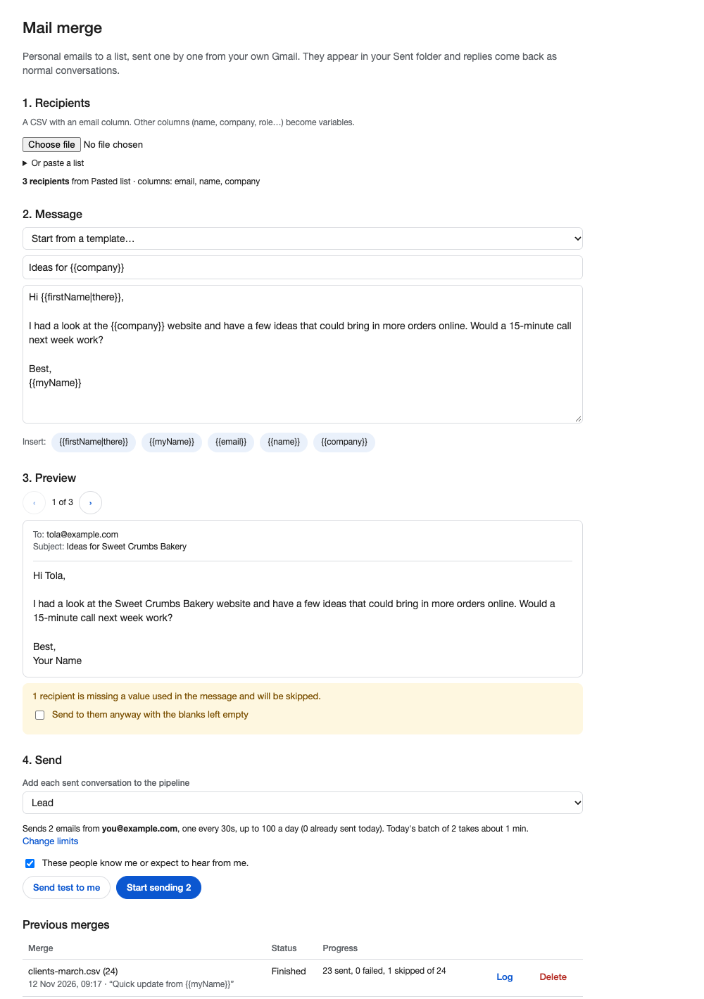
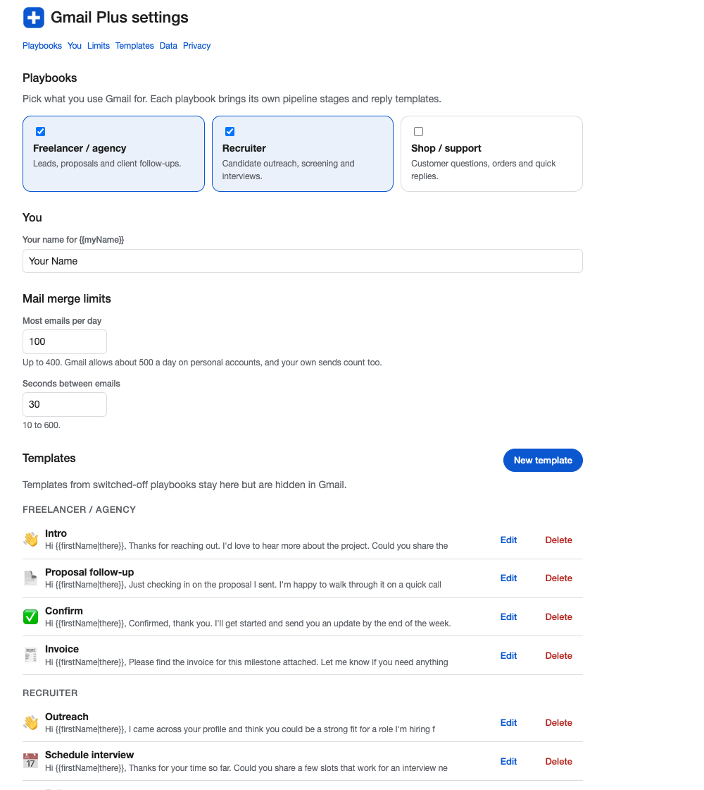
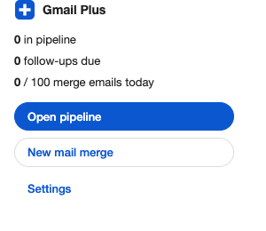

# Gmail Plus

[](https://github.com/Round24Consult/gmail-plus/actions/workflows/ci.yml)

**A Chrome extension by [Round24 Consult](https://round24consult.com) that adds a toolbox to Gmail for freelancers,
recruiters and small shops.** It gives you one-click reply templates, a simple pipeline, follow-up reminders, contact
export and mail merge, all inside the Gmail you already use.

Everything runs and is stored in your browser. There is no server, no account, no Gmail API and no OAuth.


> **Status: v0.1.0, early preview.** The extension loads in Gmail, adds its menu items and shows the Pipeline board. The
> other tools are built and unit-tested but have not all been tried in a live Gmail account yet. See
> [Known issues](#known-issues) before relying on it.

---

## Contents

- [What it adds to Gmail](#what-it-adds-to-gmail)
- [Playbooks](#playbooks)
- [Screenshots](#screenshots)
- [Install](#install)
- [Quick start](#quick-start)
- [Template variables](#template-variables)
- [How mail merge sends](#how-mail-merge-sends)
- [Privacy and data](#privacy-and-data)
- [Development](#development)
- [How it works](#how-it-works)
- [Known issues](#known-issues)
- [Roadmap](#roadmap)
- [Background: why Gmail, and how it compares](#background-why-gmail-and-how-it-compares)
- [Documentation](#documentation)
- [License](#license)

---

## What it adds to Gmail

| # | Tool | Where to find it | What it does |
|---|---|---|---|
| 1 | **Reply buttons** | A row of buttons above **Send** in every new email and reply | One click inserts a ready reply (👋 Intro, ✅ Confirm, 📦 Order status…), filling in the recipient's first name and your name |
| 2 | **Templates menu** | Speech-bubble icon in the compose toolbar | A searchable list of every template, plus a link to edit them |
| 3 | **Pipeline side panel** | Right sidebar when a conversation is open | Put the conversation on a stage (Lead, Proposal sent, Interview…), add notes, or take it off the pipeline |
| 4 | **Follow-up reminders** | The same side panel | Tomorrow, 3 days, 1 week or a custom time. You get a desktop notification when one is due, and it clears itself once the contact has replied |
| 5 | **Stage badges** | Inbox and every message list | A coloured label with the stage of each tracked conversation, with ⏰ when a follow-up is due |
| 6 | **Pipeline board** | **Pipeline** in Gmail's left menu | Drag-and-drop columns per stage, a "follow-ups due" banner, a tab per playbook and a CSV export |
| 7 | **Contact export** | Toolbar above the list, once you tick conversations | Downloads a CSV of everyone in the selected conversations: name, first name, email, number of conversations, last subject |
| 8 | **Mail merge** | **Mail merge** in Gmail's left menu | Upload a CSV, write or pick a template, preview each recipient, send yourself a test, then send one personal email at a time within a daily limit. Each sent email can go straight onto the pipeline |

Outside Gmail:

| # | Tool | Where | What it does |
|---|---|---|---|
| 9 | **Popup** | The extension icon in Chrome's toolbar | Counts (pipeline, follow-ups due, merge emails today) and shortcuts to the board, mail merge and settings |
| 10 | **Settings page** | Popup, then **Settings** | Pick playbooks, set your name, set mail merge limits, edit templates, back up, restore or delete your data |

## Playbooks

A playbook is a preset for one kind of work. Each one brings its own pipeline stages and starter templates. Switch on any
combination in Settings; the board shows one tab per active playbook.

| Playbook | Pipeline stages | Starter templates |
|---|---|---|
| **Freelancer / agency** | Lead → Proposal sent → Negotiating → Won / Lost | 👋 Intro · 📄 Proposal follow-up · ✅ Confirm · 🧾 Invoice |
| **Recruiter** | Sourced → Contacted → Screening → Interview → Offer → Hired / Closed | 👋 Outreach · 📅 Schedule interview · 🔁 Follow up · 🙏 Not moving forward |
| **Shop / support** | New → Waiting on customer → Resolved | 👋 Greeting · 📦 Order status · ❓ Need more info · ✅ Resolved |

You can edit or delete any starter template and add your own under **My templates**. Deleted starters can be restored
from Settings. Pipeline stages are fixed in this version.

## Screenshots

These were rendered with sample data, not a real mailbox.

| Mail merge | Settings |
|---|---|
|  |  |

Popup:



## Install

Gmail Plus is not on the Chrome Web Store yet. To try it, load it as an unpacked extension.

1. Install [Node.js](https://nodejs.org/) 20 or newer (the project uses 24; see `.nvmrc`).
2. Clone and build:

   ```bash
   git clone git@github.com:Round24Consult/gmail-plus.git
   cd gmail-plus
   npm install
   npm run build
   ```

3. In Chrome, open `chrome://extensions` and switch on **Developer mode** (top right).
4. Click **Load unpacked** and choose the `dist` folder.
5. Reload any open Gmail tab.

To update after pulling new code, run `npm run build`, click the reload icon on the extension's card, then refresh Gmail.

CI also builds a ready-to-load zip on every push to `main`: open the latest run under **Actions**, download the
`gmail-plus-extension` artifact, unzip it and load that folder.

## Quick start

1. **Pick your playbooks.** Settings opens when you first install. Tick what you use Gmail for and click **Done, open
   Gmail**. Add your name under **You** if it should differ from your Google account name.
2. **Reply with one click.** Open any email and click Reply. The template buttons sit above Send. Click one and it is
   inserted at the cursor with the person's first name filled in.
3. **Track a conversation.** With a conversation open, open the **Pipeline** panel in the right sidebar and choose a
   stage. A coloured badge now shows on that conversation in your inbox.
4. **Set a follow-up.** In the same panel, click **Tomorrow**, **3 days** or **1 week**. You get a notification when it
   is due. If they reply first, the reminder clears when you next open the conversation.
5. **Work the board.** Click **Pipeline** in the left menu. Drag cards between stages, open a conversation by clicking
   its subject, and export everything with **Export CSV**.
6. **Export contacts.** In any list or search, tick the conversations you want and click the download icon in the
   toolbar.
7. **Send a mail merge.** Click **Mail merge** in the left menu, load a CSV with an `email` column, write the message,
   check the preview, send a test to yourself, tick the consent box and click **Start sending**.

The [user guide](docs/USER_GUIDE.md) covers each tool in detail.

## Template variables

Templates are plain text with variables in double braces.

| Variable | Filled with |
|---|---|
| `{{firstName}}` | The recipient's first name, from their name or, failing that, their email address (`john.smith@…` gives "John"; generic inboxes like `info@` give nothing) |
| `{{name}}` | The recipient's full name |
| `{{email}}` | The recipient's email address |
| `{{myName}}` | Your name from Settings, or your Google account name |
| `{{anyColumn}}` | In mail merge, any CSV column, e.g. `{{company}}` or `{{role}}` |

Add a fallback after a pipe for when a value is missing: `Hi {{firstName|there}},` becomes "Hi there," if no first name
is found. Spelling and case don't matter: `{{First Name}}`, `{{first_name}}` and `{{firstName}}` are the same variable.

In compose, variables come from the first person in the **To** field. If a variable has no value and no fallback, it is
left blank and a message tells you which ones to fill in. A template's subject is used only when you start a new email
and the subject is still empty.

## How mail merge sends

- Each email goes out through a real Gmail compose window, from your account, exactly as if you had typed it. It lands
  in your Sent folder and replies arrive as normal conversations. Your Gmail signature is kept.
- One email at a time, with a fixed gap between them (default 30 seconds, adjustable from 10 to 600).
- A daily limit (default 100, adjustable up to 400). Gmail allows about 500 emails a day on personal accounts and your
  own sends count too, so leave headroom. Test emails count toward the limit.
- When the limit is reached the merge pauses. Press **Resume** the next day to continue where it stopped.
- Recipients missing a value used in the message are skipped, unless you tick **Send to them anyway**.
- Lists can have up to 2,000 recipients. Invalid and duplicate addresses are removed when you load the file.
- The Gmail tab must stay open while sending. Closing it pauses the merge; **Resume** picks it up. If the page closes
  while an email is being sent, that row is marked "check your Sent folder" instead of being sent again.
- A merge running in one tab shows as "Running in another tab" in the others, so two tabs can't send the same list.
- Every merge keeps a log you can download as CSV: row, email, status (sent, failed, skipped) and the reason.

Only send to people who know you or expect to hear from you. The merge asks you to confirm this before it starts.

## Privacy and data

- **Stays in your browser.** Settings, templates, pipeline entries, notes, follow-ups and mail merge lists live in
  Chrome's extension storage on your computer.
- **Nothing is sent anywhere.** Gmail Plus makes no network requests of its own and does not use the Gmail API.
  InboxSDK's optional error and usage reporting is switched off.
- **Per Chrome profile.** Data does not sync between computers. Use **Download backup** and **Restore from backup** in
  Settings to move it.
- **Easy to remove.** Delete single entries, use **Delete all data** in Settings, or remove the extension.

Permissions it asks for, and why:

| Permission | Used for |
|---|---|
| `https://mail.google.com/` | Running inside Gmail |
| `scripting` | Letting InboxSDK load its Gmail integration |
| `storage`, `unlimitedStorage` | Saving your data locally; mail merge lists can be large |
| `alarms` | Checking for due follow-ups |
| `notifications` | Follow-up reminders |

The full policy is in [PRIVACY.md](PRIVACY.md).

## Development

### Requirements

- Node.js 20+ (24 recommended, see `.nvmrc`) and npm
- Google Chrome

### Commands

| Command | What it does |
|---|---|
| `npm install` | Install dependencies |
| `npm run dev` | Build to `dist/` and rebuild on every source change |
| `npm run build` | One development build (with source maps) |
| `npm run build:prod` | Minified build without source maps |
| `npm run package` | Production build zipped to `release/gmail-plus-<version>.zip` |
| `npm test` | Unit tests (Vitest) |
| `npm run typecheck` | TypeScript type check |
| `npm run icons` | Redraw the toolbar icons in `static/icons/` |

After changing code, reload the extension in `chrome://extensions` and refresh Gmail. Files under `static/` are copied
once, so restart `npm run dev` after editing them.

### Tech stack

- **[InboxSDK](https://github.com/InboxSDK/InboxSDK)** (`@inboxsdk/core`) for every Gmail integration: compose buttons,
  sidebar panels, list badges, toolbar buttons, custom routes and nav items. Streak maintains it, so Gmail UI changes
  are handled upstream.
- **TypeScript** and **[Preact](https://preactjs.com/)** for the UI.
- **[Papa Parse](https://www.papaparse.com/)** for CSV parsing and writing.
- **[Kefir](https://kefirjs.github.io/kefir/)** streams for live inbox badges.
- **[esbuild](https://esbuild.github.io/)** for bundling, **[Vitest](https://vitest.dev/)** for tests.
- Chrome **Manifest V3**.

### Project layout

```text
gmail-plus/
├── build.mjs                  # esbuild build: dist/ from src/ and static/
├── scripts/
│   ├── make-icons.mjs         # draws the PNG toolbar icons
│   └── package.mjs            # zips dist/ for the Chrome Web Store
├── src/
│   ├── config.ts              # InboxSDK app id, app name, route ids, message types
│   ├── content/               # runs inside Gmail
│   │   ├── index.tsx          # loads InboxSDK, registers every feature
│   │   ├── context.ts         # shared helpers (account, icons, messaging)
│   │   ├── theme.ts           # matches Gmail's light or dark theme
│   │   ├── mergeRunner.ts     # sends merge emails through Gmail compose
│   │   ├── features/          # templates, pipeline, export, mailmerge
│   │   └── ui/                # Board and MergeWizard screens
│   ├── background/index.ts    # service worker: InboxSDK loader, alarms, notifications
│   ├── options/index.tsx      # settings page
│   ├── popup/index.tsx        # toolbar popup
│   ├── shared/                # live store, chrome.storage binding, download, dates
│   └── lib/                   # pure logic, unit-tested
│       ├── storage.ts         # data model, migrations, backup and restore
│       ├── template.ts        # variables, fallbacks, HTML rendering
│       ├── csv.ts             # recipient parsing, validation, safe CSV export
│       ├── sendQueue.ts       # paced sending, daily limit, pause and resume
│       ├── playbooks.ts       # stages and starter templates
│       ├── names.ts           # first-name detection
│       └── types.ts
├── static/                    # manifest, HTML pages, CSS, icons
├── tests/                     # Vitest suites for src/lib and the merge runner
└── docs/                      # user guide, architecture, releasing, images
```

### Tests

```bash
npm test
```

The suites cover template rendering and fallbacks, first-name detection, CSV edge cases (quotes, commas, BOM, blank and
duplicate rows, formula injection), storage migrations and backups, the send queue (pacing, daily limit across midnight,
pause, resume, stop, failures and skips) and mail merge recovery. Gmail itself can't be unit-tested; see the manual
checklist in [CONTRIBUTING.md](CONTRIBUTING.md).

## How it works

Gmail Plus follows InboxSDK's Manifest V3 layout:

- **`content.js`** runs on `mail.google.com`. It loads InboxSDK and registers each feature.
- **`background.js`** is the service worker. It runs InboxSDK's loader, which injects **`pageWorld.js`** (copied
  unchanged from the package) into the Gmail page, and it handles follow-up alarms and notifications.
- **`options.js`** and **`popup.js`** are the settings page and toolbar popup.

All screens read one shared store kept in `chrome.storage.local` and update live when any tab changes it. See
[docs/ARCHITECTURE.md](docs/ARCHITECTURE.md) for the data model, message flow and the mail merge safeguards.

## Known issues

- **Testing in live Gmail is incomplete.** Confirmed so far: the extension loads, **Pipeline** and **Mail merge**
  appear in the left menu, the board renders and follows Gmail's dark theme. Not yet confirmed in a live account:
  compose reply buttons, the side panel, inbox badges, follow-up notifications, contact export and real mail merge sends.
- **Left-menu icons don't show.** The Pipeline and Mail merge items appear without icons in the current Gmail layout.
- **Mail merge needs an open Gmail tab.** Sending pauses when the tab closes.
- **Contact export covers selected conversations only**, so at most one page of a list at a time.
- **Reply detection for follow-ups runs when you open the conversation.** A reminder that is already due still notifies
  you even if the contact replied and you haven't opened it yet.
- **Overlap with Streak.** The pipeline and mail merge overlap with [Streak](https://www.streak.com/), which uses the
  same InboxSDK. Both run side by side without conflict.

## Roadmap

- Fix the left-menu icons and finish the live Gmail checklist.
- Editable pipeline stages.
- Follow-up sequences, a "waiting on my reply" view, quick replies with attachments, and a privacy blur for screen
  sharing.
- v2 with a backend: accounts and paid tiers (Supabase and Paddle), scheduled sends and reminders that work with Gmail
  closed (needs the `gmail.send` scope: Google verification, but not the yearly CASA assessment that read scopes need),
  webhooks and Google Sheets sync, AI reply drafts.

## Background: why Gmail, and how it compares

The idea came from [WA Web Plus](https://wawplus.com/en), a Chrome extension that adds broadcasting, quick replies,
contact export and other tools to WhatsApp Web. It reaches into WhatsApp's internal code and needs a fix release every
few weeks when WhatsApp changes.

We chose Gmail over Facebook, Instagram or WhatsApp because:

- **Meta forbids automation through extensions.** Its terms bar automated access, it has sued extension makers over
  scraping, and broadcast or auto-reply tools get accounts blocked.
- **Gmail has a supported route.** InboxSDK is open source (MIT or Apache-2.0), actively maintained, and absorbs Gmail's
  UI changes.
- **No Google review is needed for v1.** Working only inside the Gmail page avoids the Gmail API's restricted scopes,
  which require a yearly third-party security assessment (CASA).

How it compares:

| | WA Web Plus | Streak | Gmail Plus |
|---|---|---|---|
| Platform | WhatsApp Web | Gmail | Gmail |
| Shape | Toolbox of power features | Full CRM | Toolbox plus a light pipeline |
| One-click reply buttons | Yes | Snippets | Yes |
| Ready-made setups per job | No | Pipeline templates | Playbooks (stages and reply templates) |
| Where data lives | Mostly in the browser; cloud for sync | Streak's servers | Only in the browser |
| Account needed | For paid plans | Yes | No |

## Documentation

- [User guide](docs/USER_GUIDE.md): every tool, step by step
- [Architecture](docs/ARCHITECTURE.md): how the pieces fit, data model, mail merge safeguards
- [Releasing](docs/RELEASING.md): Chrome Web Store checklist
- [Contributing](CONTRIBUTING.md): development workflow and the manual Gmail checklist
- [Changelog](CHANGELOG.md)
- [Privacy policy](PRIVACY.md)

## License

Proprietary. Copyright © 2026 Round24 Consult. All rights reserved. See [LICENSE](LICENSE). Third-party packages keep
their own licences.
