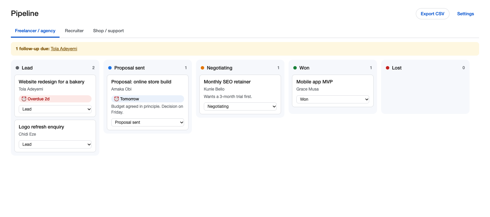
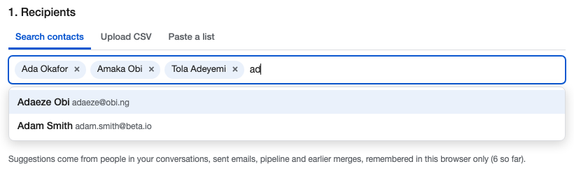
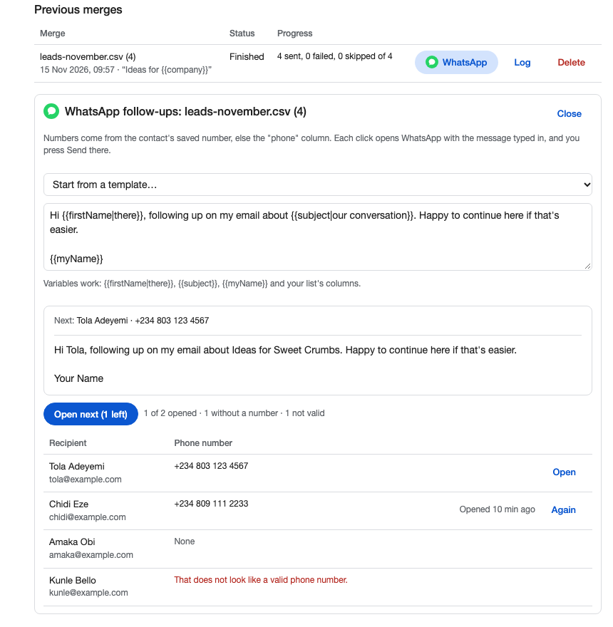
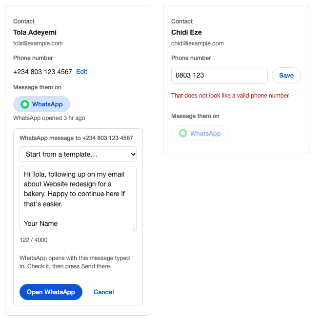
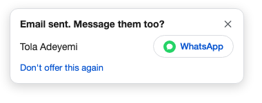

# Gmail Plus

[](https://github.com/Round24Consult/gmail-plus/actions/workflows/ci.yml)
[](LICENSE)

**An open-source Chrome extension that adds a toolbox to Gmail for freelancers, recruiters, small shops, or any workflow
you define.** It gives you one-click reply templates, a configurable pipeline, follow-up reminders, contact export, mail
merge and WhatsApp follow-ups, all inside the Gmail you already use.

Everything runs and is stored in your browser. There is no server, no account, no Gmail API and no OAuth. Branding,
limits and playbooks are all configuration, so you can build your own version without touching the code.

Maintained by [Round24 Consult](https://round24consult.com).



> **Status: v0.3.0, early preview.** The extension loads in Gmail, adds its menu items and shows the Pipeline board. The
> other tools are built and unit-tested but have not all been tried in a live Gmail account yet. See
> [Known issues](#known-issues).

---

## Contents

- [What it adds to Gmail](#what-it-adds-to-gmail)
- [Playbooks](#playbooks)
- [WhatsApp and other connectors](#whatsapp-and-other-connectors)
- [Screenshots](#screenshots)
- [Install](#install)
- [Quick start](#quick-start)
- [Configuration](#configuration)
- [Template variables](#template-variables)
- [How mail merge sends](#how-mail-merge-sends)
- [Privacy and data](#privacy-and-data)
- [Development](#development)
- [How it works](#how-it-works)
- [Known issues](#known-issues)
- [Roadmap](#roadmap)
- [Contributing](#contributing)
- [Background: why Gmail, and how it compares](#background-why-gmail-and-how-it-compares)
- [Documentation](#documentation)
- [License](#license)

---

## What it adds to Gmail

| # | Tool | Where to find it | What it does |
|---|---|---|---|
| 1 | **Reply buttons** | A row of buttons above **Send** in every new email and reply | One click inserts a ready reply (👋 Intro, ✅ Confirm, 📦 Order status…), filling in the recipient's first name and your name |
| 2 | **Templates menu** | Speech-bubble icon in the compose toolbar | A searchable list of every template, plus a link to edit them |
| 3 | **Pipeline side panel** | Right sidebar when a conversation is open | Put the conversation on a stage (Lead, Proposal sent, Interview…), add notes, or take it off the pipeline |
| 4 | **Follow-up reminders** | The same side panel | Tomorrow, 3 days, 1 week or a custom time. You get a desktop notification when one is due, and it clears itself once the contact has replied |
| 5 | **Stage badges** | Inbox and every message list | A coloured label with the stage of each tracked conversation, with ⏰ when a follow-up is due |
| 6 | **Pipeline board** | **Pipeline** in Gmail's left menu | Drag-and-drop columns per stage, a "follow-ups due" banner, a tab per playbook, a CSV export, and a WhatsApp button on cards whose contact has a saved number |
| 7 | **Contact export** | Toolbar above the list, once you tick conversations | Downloads a CSV of everyone in the selected conversations |
| 8 | **Mail merge** | **Mail merge** in Gmail's left menu | Pick recipients by searching your contacts (or a whole pipeline stage), upload a CSV or paste a list. Write or pick a template, preview each recipient, send yourself a test, then send one personal email at a time within a daily limit. Each sent email can go straight onto the pipeline |
| 9 | **Contact panel** | Right sidebar (the person icon) when a conversation is open | Save the other person's phone number once. Then write a WhatsApp message (from your default text or any template) and open it in WhatsApp |
| 10 | **WhatsApp after a merge** | **Mail merge** → Previous merges → **WhatsApp** | For lists with a phone column: a follow-up list where **Open next** opens one WhatsApp chat at a time with a personal message ready |
| 11 | **After-send offer** | A small card at the bottom left, right after you send | When you email someone whose number is saved, it offers to message them on WhatsApp too |

Outside Gmail:

| # | Tool | Where | What it does |
|---|---|---|---|
| 12 | **Popup** | The extension icon in Chrome's toolbar | Counts (pipeline, follow-ups due, merge emails today) and shortcuts |
| 13 | **Settings page** | Popup, then **Settings** | Playbooks and stages, your name, mail merge limits, templates, connectors, backup, restore and delete |

## Playbooks

A playbook is a preset for one kind of work: pipeline stages plus starter reply templates. Three ship with the extension:

| Playbook | Pipeline stages | Starter templates |
|---|---|---|
| **Freelancer / agency** | Lead → Proposal sent → Negotiating → Won / Lost | 👋 Intro · 📄 Proposal follow-up · ✅ Confirm · 🧾 Invoice |
| **Recruiter** | Sourced → Contacted → Screening → Interview → Offer → Hired / Closed | 👋 Outreach · 📅 Schedule interview · 🔁 Follow up · 🙏 Not moving forward |
| **Shop / support** | New → Waiting on customer → Resolved | 👋 Greeting · 📦 Order status · ❓ Need more info · ✅ Resolved |

Everything about them is editable:

- **In the extension:**
  - Switch playbooks on and off.
  - Rename them.
  - Add, rename, recolour, reorder and delete stages.
  - Create your own playbook (for example "Real estate" or "Events").
  - Edit, add or delete templates.
- **In the code:** each bundled playbook is one JSON file in [`playbooks/`](playbooks). Add a file and it ships, with no
  code change. See [docs/PLAYBOOKS.md](docs/PLAYBOOKS.md).

## WhatsApp and other connectors

Connectors let you reach a contact on another app without leaving Gmail. WhatsApp is the first one.

- **You press Send.** The extension opens WhatsApp (WhatsApp Web, or the app via wa.me) with the number and your message
  already typed in. It uses WhatsApp's own [click to chat](https://faq.whatsapp.com/5913398998672934) links, so there is
  no WhatsApp Business account, no API key, no cost per message, and no automation that could get your number banned.
- **Numbers are saved once per person.** Add a number in the Contact panel, or include a `phone`, `mobile` or `whatsapp`
  column in a mail merge list. Numbers without a country code use the default country you pick in Settings.
- **Messages use your templates.** A default follow-up message (editable in Settings) or any reply template, with the same
  variables as email, plus `{{subject}}` for the email you're following up.

Connectors are built to grow. Each one is a single file in
[`src/lib/connectors/catalog/`](src/lib/connectors/catalog), contacts can hold any kind of address, and a build can ship
any set of connectors (`CONNECTORS=whatsapp`). A future connector can also send through a provider's API instead of
opening a link. See [docs/CONNECTORS.md](docs/CONNECTORS.md).

## Screenshots

These were rendered with sample data, not a real mailbox.

| Mail merge | Settings: playbooks and stages |
|---|---|
|  |  |

Recipient search in mail merge:



| WhatsApp follow-ups after a merge | Contact panel |
|---|---|
|  |  |

Right after sending an email to someone with a saved number:



Popup:


## Install

The extension isn't on the Chrome Web Store yet. To use it, build it and load it unpacked.

1. Install [Node.js](https://nodejs.org/) 20 or newer (24 recommended; see `.nvmrc`).
2. Clone, configure and build:

   ```bash
   git clone https://github.com/Round24Consult/gmail-plus.git
   cd gmail-plus
   npm install
   cp .env.example .env      # then set INBOXSDK_APP_ID (see below)
   npm run build
   ```

3. Get a free InboxSDK app id at <https://register.inboxsdk.com/>. The label must be 5 to 15 letters or digits, for
   example `MyGmailTools`. Put it in `.env` as `INBOXSDK_APP_ID=sdk_MyGmailTools_…` and run `npm run build` again.
   Without it everything still works, but Gmail shows a red "Invalid AppId" developer banner.
4. In Chrome, open `chrome://extensions`, switch on **Developer mode**, click **Load unpacked** and choose the `dist`
   folder.
5. Reload any open Gmail tab.

To update: `git pull`, `npm install`, `npm run build`, click the reload icon on the extension's card, refresh Gmail.

Every push to `main` also produces a ready-to-load zip under **Actions** → latest run → **extension-zip**.

## Quick start

1. **Pick your playbooks.** Settings opens when you first install. Tick what you use Gmail for and click **Done, open
   Gmail**.
2. **Reply with one click.** Open any email and click Reply. The template buttons sit above Send.
3. **Track a conversation.** With a conversation open, open the **Pipeline** panel in the right sidebar and choose a
   stage. A coloured badge now shows on it in your inbox.
4. **Set a follow-up.** In the same panel, click **Tomorrow**, **3 days** or **1 week**.
5. **Work the board.** Click **Pipeline** in the left menu. Drag cards between stages, or export with **Export CSV**.
6. **Export contacts.** In any list, tick conversations and click the download icon in the toolbar.
7. **Send a mail merge.** Click **Mail merge**, then search for people by name or email (or upload a CSV, or paste a
   list), write the message, check the preview, send a test to yourself, confirm and start.
8. **Follow up on WhatsApp.** Open a conversation, save the person's number in the **Contact** panel and click
   **WhatsApp**. After a merge whose list has a `phone` column, click **WhatsApp** next to it under Previous merges.

The [user guide](docs/USER_GUIDE.md) covers each tool in detail.

## Configuration

Branding, limits and playbooks come from configuration, not code. A build combines `config/defaults.json`, your `.env`,
environment variables and every file in `playbooks/`.

| Variable | Default | Purpose |
|---|---|---|
| `INBOXSDK_APP_ID` | *(empty)* | Your InboxSDK app id |
| `APP_NAME`, `APP_SHORT_NAME`, `APP_DESCRIPTION` | Gmail Plus… | Branding in Chrome, Settings and messages |
| `APP_SLUG` | `gmail-plus` | Route names, file names, backup format |
| `SUPPORT_EMAIL`, `HOMEPAGE_URL`, `PRIVACY_POLICY_URL` | | Links shown in Settings |
| `MERGE_DEFAULT_DAILY_CAP`, `MERGE_MAX_DAILY_CAP` | 100, 400 | Daily mail merge limit and its ceiling |
| `MERGE_DEFAULT_INTERVAL_SEC`, `MERGE_MIN_INTERVAL_SEC`, `MERGE_MAX_INTERVAL_SEC` | 30, 10, 600 | Gap between merge emails |
| `MERGE_MAX_RECIPIENTS` | 2000 | Largest list per merge |
| `FOLLOW_UP_SWEEP_MINUTES`, `FOLLOW_UP_REMINDER_HOUR` | 15, 9 | Reminder check interval and quick-pick hour |
| `PLAYBOOKS`, `DEFAULT_PLAYBOOKS` | all | Which playbook files ship, and which are on at first run |
| `CONNECTORS` | `whatsapp` | Which connectors ship (`none` for none) |
| `DEFAULT_COUNTRY` | *(empty)* | Country for phone numbers without a country code, e.g. `GB` or `NG` |
| `CONNECTOR_MESSAGE` | Follow-up text | The default WhatsApp message (`\n` for a new line) |

Example white-label build:

```bash
APP_NAME="Hire Desk for Gmail" APP_SLUG=hire-desk PLAYBOOKS=recruiter npm run package
```

The build validates everything and stops with a clear list of problems. Full reference:
[docs/CONFIGURATION.md](docs/CONFIGURATION.md).

## Template variables

| Variable | Filled with |
|---|---|
| `{{firstName}}` | The recipient's first name, from their name or, failing that, their email address (`john.smith@…` gives "John"; `info@` gives nothing) |
| `{{name}}` | The recipient's full name |
| `{{email}}` | The recipient's email address |
| `{{myName}}` | Your name from Settings, or your Google account name |
| `{{anyColumn}}` | In mail merge, any CSV column, e.g. `{{company}}` |
| `{{subject}}` | In WhatsApp messages, the subject of the email you're following up (without "Re:") |

- **Fallbacks:** `Hi {{firstName|there}},` becomes "Hi there," when no first name is found.
- **Spelling and case don't matter:** `{{First Name}}`, `{{first_name}}` and `{{firstName}}` are the same variable.
- **In compose,** values come from the first person in **To**. Missing values are left blank and listed in a message.

## How mail merge sends

- **From your account.** Each email goes out through a real Gmail compose window, exactly as if you typed it. It lands
  in Sent, replies arrive as normal conversations, and your signature is kept.
- **Paced.**
  - One email at a time, with a fixed gap (default 30 s).
  - A daily limit (default 100). Test emails count toward it.
  - At the limit the merge pauses; **Resume** continues the next day.
- **Careful with data.**
  - Rows missing a value used in the message are skipped unless you choose otherwise.
  - Invalid and duplicate addresses are removed on load.
  - Lists can have up to 2,000 recipients (configurable).
- **Safe against double sends.**
  - A merge runs in one tab at a time. Closing the tab pauses it.
  - If the page closes mid-send, that row is marked "check your Sent folder" instead of being sent twice.
- **Logged.** Every merge keeps a downloadable log of each row's result.

Only send to people who know you or expect to hear from you. The merge asks you to confirm this before it starts.

## Privacy and data

- **Stays in your browser.** Everything lives in Chrome's extension storage on your computer.
- **Nothing is sent anywhere.** No network requests of its own, and no Gmail API. InboxSDK's optional error and usage
  reporting is switched off.
- **Recipient suggestions are local.** To suggest mail merge recipients, the extension remembers the names and
  addresses of people in conversations you see and emails you send, in your browser only. Switch it off or forget them
  in Settings → Your data.
- **WhatsApp only when you click.** Opening WhatsApp loads WhatsApp's own link with the number and message in it, in a
  normal browser tab. Phone numbers you save stay in your browser.
- **Portable.** Download a backup and restore it on another computer.
- **Easy to remove.** Delete entries, delete all data in Settings, or remove the extension.

| Permission | Used for |
|---|---|
| `https://mail.google.com/` | Running inside Gmail |
| `scripting` | Letting InboxSDK load its Gmail integration |
| `storage`, `unlimitedStorage` | Saving your data locally; mail merge lists can be large |
| `alarms` | Checking for due follow-ups |
| `notifications` | Follow-up reminders |

The WhatsApp connector needs no extra permission. Full policy: [PRIVACY.md](PRIVACY.md).

## Development

| Command | What it does |
|---|---|
| `npm run dev` | Build to `dist/` and rebuild on every source change |
| `npm run build` | One development build (with source maps) |
| `npm run build:prod` | Minified build without source maps |
| `npm run package` | Production build zipped to `release/<slug>-<version>.zip` |
| `npm test` | Unit tests (Vitest) |
| `npm run typecheck` | TypeScript type check |
| `npm run icons` | Redraw the toolbar icons |

After a change, reload the extension in `chrome://extensions` and refresh Gmail. Restart `npm run dev` after editing
`static/`, `config/`, `playbooks/` or `.env`.

**Stack:**

- [InboxSDK](https://github.com/InboxSDK/InboxSDK) for every Gmail integration
- TypeScript and [Preact](https://preactjs.com/)
- [Papa Parse](https://www.papaparse.com/) for CSV
- [libphonenumber-js](https://gitlab.com/catamphetamine/libphonenumber-js) for phone numbers
- [Kefir](https://kefirjs.github.io/kefir/) for live badges
- [esbuild](https://esbuild.github.io/) and [Vitest](https://vitest.dev/)
- Chrome Manifest V3

```text
gmail-plus/
├── config/defaults.json       # default configuration (override with .env / env vars)
├── playbooks/*.json           # bundled playbooks: stages and starter templates
├── build.mjs                  # esbuild build into dist/
├── scripts/
│   ├── load-config.mjs        # merges and validates configuration and playbooks
│   ├── make-icons.mjs         # draws the PNG toolbar icons
│   └── package.mjs            # zips dist/ for the Chrome Web Store
├── src/
│   ├── config.ts              # CONFIG injected at build time
│   ├── content/               # runs inside Gmail: features, board, mail merge
│   ├── background/            # service worker: InboxSDK loader, alarms, notifications
│   ├── options/ popup/        # settings page and toolbar popup
│   ├── shared/                # live store, chrome.storage binding, helpers
│   └── lib/                   # pure, unit-tested logic: storage, templates, CSV, send queue, playbooks
│       └── connectors/        # connector registry, address kinds, phone numbers; catalog/ has one file per app
├── static/                    # manifest, HTML, CSS, icons
├── tests/                     # Vitest suites
└── docs/                      # guides and images
```

**Tests** (`npm test`, 166 tests) cover:

- configuration loading and validation
- connectors: phone numbers, WhatsApp links, the registry, contact cards
- recipient search: the local address book, ranking and pasted address lists
- template rendering and first-name detection
- CSV edge cases and formula-injection protection
- storage migrations, backups, and playbook and stage editing
- the send queue: pacing, daily limit, pause, resume and stop
- mail merge recovery

## How it works

- **`content.js`** runs on `mail.google.com`. It loads InboxSDK and registers each feature.
- **`background.js`** is the service worker. It runs InboxSDK's loader, which injects `pageWorld.js` into Gmail, handles
  reminders, and opens connector links after checking them.
- **Settings page and popup** are plain extension pages.

All screens share one store in `chrome.storage.local` and update live. Configuration is injected at build time. Details,
data model and the mail merge safeguards are in [docs/ARCHITECTURE.md](docs/ARCHITECTURE.md).

## Known issues

- **Testing in live Gmail is incomplete.**
  - Confirmed: the extension loads, its menu items appear, and the board renders and follows Gmail's dark theme.
  - Not yet confirmed: reply buttons, the side panels, badges, notifications, contact export, real mail merge sends and
    the WhatsApp connector.
- **WhatsApp Web reloads for each message.** It's how its click-to-chat link works; the extension reuses one tab.
- **Left-menu icons** don't show in the current Gmail layout.
- **Mail merge needs an open Gmail tab.** Sending pauses when the tab closes.
- **Contact export** covers selected conversations only: at most one page of a list at a time.
- **Follow-up reply detection** runs when you open the conversation.
- **Overlap with [Streak](https://www.streak.com/)**, which uses the same InboxSDK. Both run side by side.

## Roadmap

- Fix the left-menu icons; finish the live Gmail checklist.
- Follow-up sequences, a "waiting on my reply" view, quick replies with attachments, a privacy blur for screen sharing.
- More connectors: SMS and Telegram links, then optional API connectors (for example the WhatsApp Cloud API with your
  own Meta key) for sending without a click. See [docs/CONNECTORS.md](docs/CONNECTORS.md).
- Translations.
- Optional backend:
  - accounts
  - scheduled sends and reminders with Gmail closed, which needs the `gmail.send` scope (Google verification, but not
    the CASA assessment that read scopes need)
  - webhooks and Google Sheets sync
  - AI reply drafts

## Contributing

Contributions are welcome, especially new playbooks, bug reports from real Gmail use, and fixes for the known issues.

- [CONTRIBUTING.md](CONTRIBUTING.md): setup, workflow and the manual Gmail checklist
- [docs/PLAYBOOKS.md](docs/PLAYBOOKS.md): add a playbook with one JSON file
- [CODE_OF_CONDUCT.md](CODE_OF_CONDUCT.md) and [SECURITY.md](SECURITY.md)

## Background: why Gmail, and how it compares

The idea came from [WA Web Plus](https://wawplus.com/en), which adds broadcasting, quick replies and contact export to
WhatsApp Web by reaching into WhatsApp's internal code.

We built for Gmail instead of Facebook, Instagram or WhatsApp because:

- **Meta forbids automation through extensions.** Its terms bar automated access, it has sued extension makers over
  scraping, and broadcast or auto-reply tools get accounts blocked.
- **Gmail has a supported route.** InboxSDK is open source (MIT or Apache-2.0), maintained, and absorbs Gmail's UI
  changes.
- **No Google review is needed.** Working only inside the Gmail page avoids the Gmail API's restricted scopes and their
  yearly security assessment.

| | WA Web Plus | Streak | Gmail Plus |
|---|---|---|---|
| Platform | WhatsApp Web | Gmail | Gmail |
| Shape | Toolbox of power features | Full CRM | Toolbox plus a light pipeline |
| One-click reply buttons | Yes | Snippets | Yes |
| Ready-made setups per job | No | Pipeline templates | Playbooks, editable and extensible |
| Where data lives | Mostly in the browser; cloud for sync | Streak's servers | Only in the browser |
| Account needed | For paid plans | Yes | No |
| Source code | Closed | Closed (SDK is open) | Open (MIT) |

## Documentation

- [User guide](docs/USER_GUIDE.md): every tool, step by step
- [Configuration](docs/CONFIGURATION.md): every setting and how builds use them
- [Playbooks](docs/PLAYBOOKS.md): the playbook file format and how updates reach users
- [Connectors](docs/CONNECTORS.md): WhatsApp, and how to add another app
- [Architecture](docs/ARCHITECTURE.md): bundles, data model, mail merge safeguards
- [Releasing](docs/RELEASING.md): Chrome Web Store checklist
- [Contributing](CONTRIBUTING.md) · [Changelog](CHANGELOG.md) · [Privacy policy](PRIVACY.md) · [Security](SECURITY.md)

## License

[MIT](LICENSE) © 2026 Round24 Consult. Third-party packages keep their own licences (InboxSDK: MIT or Apache-2.0; Preact,
Papa Parse, Kefir, libphonenumber-js: MIT).

"Gmail" is a trademark of Google LLC and "WhatsApp" is a trademark of WhatsApp LLC. This project is not affiliated with
or endorsed by Google or Meta.
