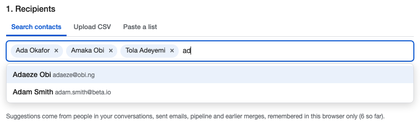

# User guide

This guide walks through every Gmail Plus tool. For installation see the [README](../README.md#install).

- [First run](#first-run)
- [Reply buttons and the templates menu](#reply-buttons-and-the-templates-menu)
- [Pipeline side panel](#pipeline-side-panel)
- [Follow-up reminders](#follow-up-reminders)
- [Stage badges](#stage-badges)
- [Pipeline board](#pipeline-board)
- [Contact export](#contact-export)
- [Mail merge](#mail-merge)
- [WhatsApp](#whatsapp)
- [Settings](#settings)
- [Popup](#popup)
- [Troubleshooting](#troubleshooting)

## First run

When you install Gmail Plus, its settings page opens.

1. Under **Playbooks**, tick what you use Gmail for: Freelancer / agency, Recruiter, Shop / support, or more than one.
2. Click **Done, open Gmail**.
3. Optional: under **You**, type the name to use for `{{myName}}`. If you leave it empty, your Google account name is
   used.

Until you finish this step, Gmail shows a short reminder at the top of the page each time it loads.

## Reply buttons and the templates menu

**Reply buttons** appear as a row of chips above the Send button in every new email, reply and forward. Each chip is a
template from your active playbooks plus any of your own. The ✎ chip at the end opens the template editor.

Click a chip to insert the template at the cursor. Variables are filled from the first person in **To**:

- `{{firstName|there}}` becomes their first name, or "there" if none can be found.
- `{{myName}}` becomes your name.

If a variable has no value and no fallback, it is left blank and a message at the top of Gmail lists what to fill in.

If the template has a subject and you are writing a **new** email with an empty subject, the subject is filled too.
Replies keep their existing subject.

The **templates menu** is the speech-bubble icon in the compose toolbar. It shows the same templates grouped by playbook,
each with a preview line. With more than six templates there is a search box at the top. **Edit templates…** at the
bottom opens Settings.

## Pipeline side panel

Open any conversation, then open the **Pipeline** panel from the right sidebar (the icon with three bars).

- **Not tracked yet:** choose a stage from **Add to pipeline…**. The panel records the subject and the other person in
  the conversation, meaning the latest sender who isn't you, or else someone you wrote to.
- **Tracked:** the panel shows the contact, the current stage (change it at any time), follow-up controls and notes.
  Notes save when you click away from the box.
- **Open pipeline** goes to the board. **Remove from pipeline** forgets the conversation; the emails themselves are not
  touched.

Stages from every active playbook are listed, grouped by playbook.

## Follow-up reminders

In the side panel of a tracked conversation:

1. Click **Tomorrow**, **3 days** or **1 week** (each is 9:00 that day), or pick a date and time and click **Set**.
2. When the time comes you get a desktop notification titled "Follow up with …". Clicking it opens the conversation in
   Gmail.
3. The reminder clears itself when the contact replies: the next time you open the conversation, if a newer message is
   from them, the follow-up is marked done and a message says so.
4. You can also click **Done** or **Remove** yourself.

Notes:

- Due follow-ups also show on the board and as ⏰ on inbox badges.
- Notifications need Chrome running. Reminders that came due while Chrome was closed are shown when it starts again.
- If notifications don't appear, check that Chrome is allowed to show notifications in your operating system settings.

## Stage badges

Every tracked conversation shows a coloured badge with its stage name in the inbox, in labels and in search results. A ⏰
in front of the name means a follow-up is due. Badges update straight away when you change a stage anywhere.

## Pipeline board

Click **Pipeline** in Gmail's left menu.

- **Tabs** switch between your active playbooks.
- **Columns** are stages. Each shows how many conversations it holds.
- **Cards** show the subject, contact, follow-up status and the start of your notes. Click the subject to open the
  conversation. Drag a card to another column, or use the stage menu on the card, to move it.
- Cards with a due follow-up come first in each column; the rest are sorted by most recently updated.
- The yellow **follow-ups due** banner lists the people to chase, with links to their conversations.
- A green **WhatsApp** icon on a card means the contact has a saved number. Click it to open WhatsApp with your default
  message.
- **Export CSV** downloads every tracked conversation for this Gmail account with these columns: name, email, phone,
  subject, stage, playbook, follow_up, notes, updated.

Only conversations from the Gmail account you are signed in to are shown. If you use several Gmail accounts, each has its
own pipeline.

## Contact export

1. Go to any list: Inbox, a label, Sent or a search.
2. Tick the conversations you want. Gmail's select-all checkbox selects the whole page.
3. Click the download icon in the toolbar above the list.

The CSV has one row per person, with your own address left out:

| Column | Meaning |
|---|---|
| `name` | Their display name, if Gmail shows one |
| `first_name` | Detected first name |
| `email` | Email address |
| `phone` | Their saved phone number, if any (see [WhatsApp](#whatsapp)) |
| `conversations` | How many of the selected conversations they appear in |
| `last_subject` | Subject of their most recent selected conversation (lists run newest first) |

The file is UTF-8 with a byte-order mark, so Excel shows accented names correctly. Values that start with `=`, `+`, `-`
or `@` get a leading apostrophe so spreadsheet apps don't run them as formulas.

## Mail merge

Click **Mail merge** in Gmail's left menu. The screen has four steps.

### 1. Recipients

There are three ways to build the list. Whichever you use last replaces the list.

**Search contacts**

- Type part of a name or address. Suggestions appear as you type; pick one with the mouse, or with ↑/↓ and Enter.
- Type or paste a full address that isn't suggested and press Enter (or a comma) to add it. Pasting several addresses
  at once, such as `Ada Okafor <ada@x.com>, bo@y.com`, adds them all.
- **Add everyone in a pipeline stage** adds every contact tracked on that stage, for example everyone in Proposal sent.
- Remove someone with ×, or with Backspace in an empty box. **Use N recipients** turns the selection into the list.

Suggestions come from a small address book the extension keeps in your browser: people in lists and conversations you
have seen in Gmail, people you've emailed, your pipeline and saved contacts, and earlier merge lists. It fills up as you
use Gmail, so it may be short at first. It can't see your Google Contacts. To switch it off or forget everyone, see
Settings → Your data.

Picked people get `{{name}}` and `{{firstName}}` from their name, and a `phone` column when their number is saved, so
WhatsApp follow-ups work for them too.

**Upload CSV**

Choose a CSV file. It needs a header row and an email column, called `email`, `Email Address`, `mail` or similar. If no
column has a recognised name, the first column that is mostly email addresses is used. Every other column becomes a
variable: a column `Company` is `{{company}}`.

**Paste a list**

Paste CSV text with a header row, or just addresses separated by commas or new lines.

On load, Gmail Plus:

- removes duplicate addresses (case doesn't matter) and reports how many
- skips rows with a missing or invalid address and lists their line numbers
- refuses lists over 2,000 recipients; split bigger lists
- spots a phone column (`phone`, `mobile`, `whatsapp` and similar) and says you can follow up on WhatsApp after sending

### 2. Message

Optionally start from a template, then write the **Subject** and the message. Click the chips under the message to
insert a variable at the cursor; they include every column in your file.

### 3. Preview

Step through each recipient with **‹** and **›** to see exactly what they will get. If some recipients are missing a
value used in the subject or message, a yellow box says how many. They are skipped unless you tick **Send to them
anyway**, in which case the missing values are left blank.

### 4. Send

- **Add each sent conversation to the pipeline:** pick a stage to track every sent email, for example Contacted for
  recruiting outreach, or leave it on **Don't add**.
- The summary shows how many emails will go, from which account, the gap between them, today's limit and how long
  today's batch will take.
- **Send test to me** sends the currently previewed version to your own address, with "[Test]" in front of the subject.
- Tick **These people know me or expect to hear from me**, then click **Start sending**.

While sending:

- A compose window opens, fills and sends for each email. Leave it alone; it closes by itself.
- The progress bar shows how many are done, sent, failed and skipped, and when the next one goes.
- **Pause** stops after the current email. **Stop** ends the merge for good.
- Keep this Gmail tab open. You can use other tabs and windows, and even the same tab, while it runs.

**Previous merges** lists earlier runs for this account with their status. From there:

- **Resume** continues a merge that was paused, interrupted or stopped at the daily limit.
- **WhatsApp** (when the list has a phone column) opens the follow-up list described in
  [After a mail merge](#after-a-mail-merge).
- **Log** downloads a CSV with every row's result.
- **Delete** removes the merge from the list. Sent emails stay in Gmail.

Status meanings:

| Status | Meaning |
|---|---|
| Running | Sending in this tab |
| Running in another tab | Another Gmail tab is sending it; it can't be resumed here until that stops |
| Interrupted | The tab sending it closed; press Resume |
| Paused | You pressed Pause |
| Daily limit reached | The daily limit was hit; resume tomorrow or raise the limit |
| Stopped | You pressed Stop |
| Finished | Every row was handled |

## WhatsApp

Gmail Plus can open a WhatsApp chat with a contact, with your message already typed in. **You always press Send
yourself, in WhatsApp.** It uses WhatsApp's own click-to-chat links, so you need no WhatsApp Business account and nothing
is sent automatically.

The first time, WhatsApp Web asks you to link your phone (scan a QR code from WhatsApp on your phone). After that, each
message opens in the same WhatsApp Web tab. If you prefer the WhatsApp desktop app, choose **Choose each time** under
Settings → Connectors.

### Saving a number

Open a conversation and open the **Contact** panel from the right sidebar (the person icon). Type the number under
**Phone number** and click **Save**.

- Write it with the country code, like `+44 7911 123456` or `0044 7911 123456`, or set a default country in Settings so
  local numbers such as `07911 123456` work.
- The number is saved for that person (their email address), so it shows in every conversation with them.
- **Edit** changes it; **Remove** deletes it.

Numbers in a mail merge list are saved the same way when each email is sent, unless that person already has one.

### Messaging from a conversation

In the Contact panel, click **WhatsApp**. A message box opens with your default message, filled in for this person:

- **Start from a template** replaces the text with one of your reply templates.
- Edit freely. The counter shows the length (WhatsApp links take up to 4,000 characters).
- **Open WhatsApp** opens the chat with the message ready. Check it and press Send there.

The panel then shows when you last opened WhatsApp for this person.

### After you send an email

When you send an email to someone whose number is saved, a small card appears at the bottom left: "Email sent. Message
them too?". Click **WhatsApp** to open the chat with your default message, which can mention the email's subject. The
card closes by itself after 30 seconds. **Don't offer this again** switches it off (turn it back on in Settings).

Mail merge emails never show this card.

### After a mail merge

If your list had a phone column, click **WhatsApp** next to the merge under **Previous merges**:

1. Check the message. It starts from your default message; edit it or start from a template. Variables include every
   column of your list, and `{{subject}}` is the subject that person received. The text is saved with the merge. While
   the merge is still sending, the message can't be changed.
2. The **Next** box shows exactly what the next person will get.
3. Click **Open next**. WhatsApp opens for that person; press Send there, come back to Gmail and click **Open next**
   again.

The table lists everyone the merge emailed, with their number, rows without a number, and numbers that aren't valid.
If you saved or corrected someone's number in the Contact panel, that number is used instead of the list's. Opened rows
show when; **Again** reopens one.

### Default message and variables

The default message is set in Settings → Connectors. It understands the usual variables (`{{firstName|there}}`,
`{{name}}`, `{{email}}`, `{{myName}}`) plus `{{subject}}`, the subject of the email you are following up, without "Re:"
or "Fwd:". In mail merge follow-ups, every list column works too. Unfilled variables are left blank; you will see the
result in WhatsApp before sending.

## Settings

Open from the popup (**Settings**), from **Edit templates…** in the compose menu, or from `chrome://extensions` →
Gmail Plus → **Extension options**.

- **Playbooks:** switch playbooks on and off. Turning one off hides its stages and templates in Gmail but keeps your data.
- **Playbooks and stages:** open a playbook to rename it or edit its stages.
  - **Change a stage:** its colour, its name, or **Closed** (end states such as won or lost).
  - **Reorder** with the arrows; **Add stage** adds one at the end.
  - **Delete a stage:** if conversations are on it, you first choose a stage to move them to.
  - **New playbook** creates your own, starting with New, In progress and Done.
  - **Delete playbook** works once no conversations are on its stages; its templates move to My templates.
- **You:** your name for `{{myName}}`.
- **Mail merge limits:** most emails per day (1 to 400) and seconds between emails (10 to 600).
- **Connectors:**
  - Switch WhatsApp on or off, and choose where it opens: **WhatsApp Web** or **Choose each time** (wa.me, which offers
    the desktop app).
  - **Default country for phone numbers**, used for numbers written without a country code.
  - **Default message** for WhatsApp, with **Reset** to go back to the original.
  - **After I email someone whose number is saved, offer to message them too** turns the after-send card on or off.
- **Templates:**
  - **New template** adds one under My templates, or under any playbook group you choose.
  - **Edit** changes emoji, name, group, subject and body.
  - **Delete** removes a template. Starter templates can be brought back with **Restore deleted starter templates**.
- **Your data:**
  - **Remember names and addresses…** switches the recipient-search address book on or off. **Forget them** deletes
    everyone it has remembered.
  - **Download backup** saves everything as a JSON file.
  - **Restore from backup** replaces all current data with a backup's contents.
  - **Delete all data** wipes everything and starts fresh, after a confirmation.
- **Privacy:** a summary of what the extension does and doesn't do with your data.

## Popup

Click the Gmail Plus icon in Chrome's toolbar (pin it from the puzzle-piece menu if you don't see it). It shows how many
conversations are on your pipeline, how many follow-ups are due and how many merge emails you have sent today, with
buttons for the board, a new mail merge and Settings.

## Troubleshooting

| Problem | What to try |
|---|---|
| Nothing appears in Gmail | Reload Gmail. Check the extension is switched on in `chrome://extensions`. After updating the extension, always refresh Gmail. |
| Red "InboxSDK Developer Warning: Invalid AppId" banner | The build has no registered app id. Set `INBOXSDK_APP_ID` in `.env` and rebuild (see the [README](../README.md#install)). |
| Reply buttons missing | Open a fresh compose window. Check at least one playbook is on, or that you have templates under My templates. |
| No notification for a due follow-up | Check Chrome may show notifications (system settings). Chrome must be running. |
| Mail merge says "Running in another tab" | Another Gmail tab is sending that merge. Wait, or close that tab; after about a minute it shows as Interrupted and can be resumed. |
| A row failed with "check your Sent folder" | The page closed or Gmail didn't confirm while that email was sending. Look in Sent before writing to that person again. |
| Extension stopped working after an update | Remove and re-add it, then restore your backup. |
| WhatsApp says the phone number is invalid | That number isn't on WhatsApp, or it's missing its country code. Edit it in the Contact panel. |
| "Add the country code…" when saving a number | Write the number with `+` and the country code, or choose a default country in Settings → Connectors. |
| The WhatsApp button is greyed out | Save the person's phone number in the Contact panel first. |
| Recipient search doesn't find someone | It only knows people the extension has seen in Gmail since it was installed, plus your pipeline and earlier merges. Type their full address and press Enter. |
